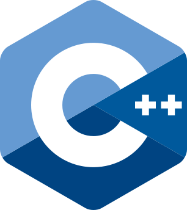
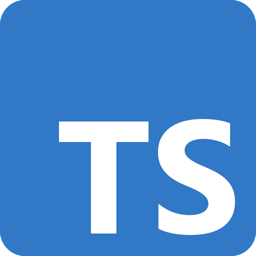

Build Apps
==========

This section describes how CCF applications can be developed and deployed to a CCF network.

.. tip:: The `ccf-app-template <https://github.com/microsoft/ccf-app-template>`_ repository can be used to quickly build and run a sample CCF application and provides a minimal template to create new CCF apps.

Applications can be written in JavaScript/TypeScript or C++. An application consists of a collection of endpoints that can be triggered by :term:`Users`. Each endpoint can define an :ref:`build_apps/example_cpp:API Schema` to validate user requests. Native applications can also be written in Rust using an :doc:`experimental interface <example_rust>`, which exposes a :doc:`reduced API <rust_api>` and does not support API schemas.

These endpoints can read or mutate the state of a unique :ref:`build_apps/kv/index:Key-Value Store` that represents the internal state of the application. Applications define a set of ``Maps`` (see :doc:`kv/kv_how_to`), mapping from a key to a value. When an application endpoint is triggered, the effects on the Store are committed atomically.

.. grid:: 1 2 2 2
    :gutter: 3

    .. grid-item-card:: :fas:`rocket` :doc:`get_started`

        Get started developing a CCF application.

    .. grid-item-card:: :fas:`download` :doc:`install_bin`

        Install CCF on Linux.

    .. grid-item-card:: |cpp| :doc:`example_cpp`

        Write, build and package a CCF application in C++.

    .. grid-item-card:: |ts| :doc:`js_app_ts`

        Write a CCF application in TypeScript using :typedoc-package:`ccf-app`.

    .. grid-item-card:: |rust| :doc:`example_rust`

        Write a native CCF application in Rust (experimental).

    .. grid-item-card:: :fas:`luggage-cart` :doc:`js_app_bundle`

        Package and deploy JavaScript/TypeScript application bundles.

    .. grid-item-card:: :fas:`file-alt` :doc:`logging`

        Log messages from a CCF application.

    .. grid-item-card:: :fas:`rocket` :doc:`run_app`

        Run a CCF application in a sandbox environment.

    .. grid-item-card:: :fas:`users` :doc:`auth/index`

        Authenticate users of a CCF application.

    .. grid-item-card:: :fas:`database` :doc:`kv/index`

        Access application state transactionally through the key-value store.

    .. grid-item-card:: :fas:`terminal` :doc:`api`

        Consult the C++ API reference.

    .. grid-item-card:: :fas:`terminal` :doc:`rust_api`

        Consult the Rust API reference (experimental).

    .. grid-item-card:: :fas:`key` :doc:`crypto`

        Use CCF cryptographic APIs.

    .. grid-item-card:: :fas:`rocket` :doc:`release_policy`

        Understand CCF release cadence and compatibility commitments.

    .. grid-item-card:: :fas:`exchange-alt` :doc:`migration_7_x_to_8_x`

        Prepare applications and deployments for CCF 8.x.

    .. grid-item-card:: :fas:`share` :doc:`fwd_to_redirect`

        Migrate from forwarding (deprecated) to redirect (recommended) endpoints.

.. toctree::
    :hidden:

    get_started
    install_bin
    example_cpp
    js_app_ts
    example_rust
    js_app_bundle
    logging
    run_app
    auth/index
    kv/index
    api
    rust_api
    crypto
    release_policy
    migration_7_x_to_8_x
    fwd_to_redirect

