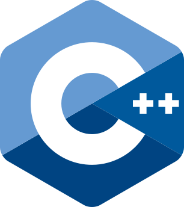
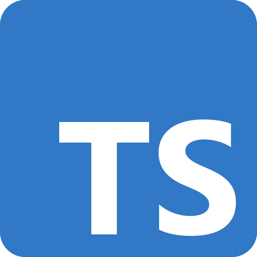

CCF Documentation
=================

.. grid:: 1 2 2 2
    :gutter: 3

    .. grid-item-card:: :fas:`info-circle` :doc:`overview/index`

        Get started with the Confidential Consortium Framework and its core concepts.

    .. grid-item-card:: :fas:`tools` :doc:`build_apps/index`

        Write application logic against the CCF key-value store in C++, JavaScript/TypeScript or Rust (experimental).

        |cpp| :doc:`C++ <build_apps/example>` \| |ts| :doc:`TypeScript <build_apps/js_app_ts>` \| |rust| :doc:`Rust <build_apps/example_rust>`

    .. grid-item-card:: :fas:`user` :doc:`use_apps/index`

        Interact with a CCF application, using HTTP over TLS.

    .. grid-item-card:: :fas:`tachometer-alt` :doc:`operations/index`

        Provision and operate a network of CCF nodes hosting an application.

    .. grid-item-card:: :fas:`users` :doc:`governance/index`

        Propose and vote changes to a CCF network, the rules that define it and the application it runs.

    .. grid-item-card:: :fas:`eye` :doc:`audit/index`

        Audit a running CCF network and its complete history.

    .. grid-item-card:: :fas:`code-branch` :doc:`contribute/index`

        Contribute to the CCF GitHub repository.

    .. grid-item-card:: :fas:`shapes` :doc:`architecture/index`

        Explore CCF design and architecture.

    .. grid-item-card:: :fas:`flask` :doc:`research/index`

        Read CCF-related research papers and technical reports.

.. toctree::
    :maxdepth: 1
    :hidden:

    overview/index.rst
    build_apps/index.rst
    use_apps/index.rst
    operations/index.rst
    governance/index.rst
    audit/index.rst
    contribute/index.rst
    architecture/index.rst
    research/index.rst

